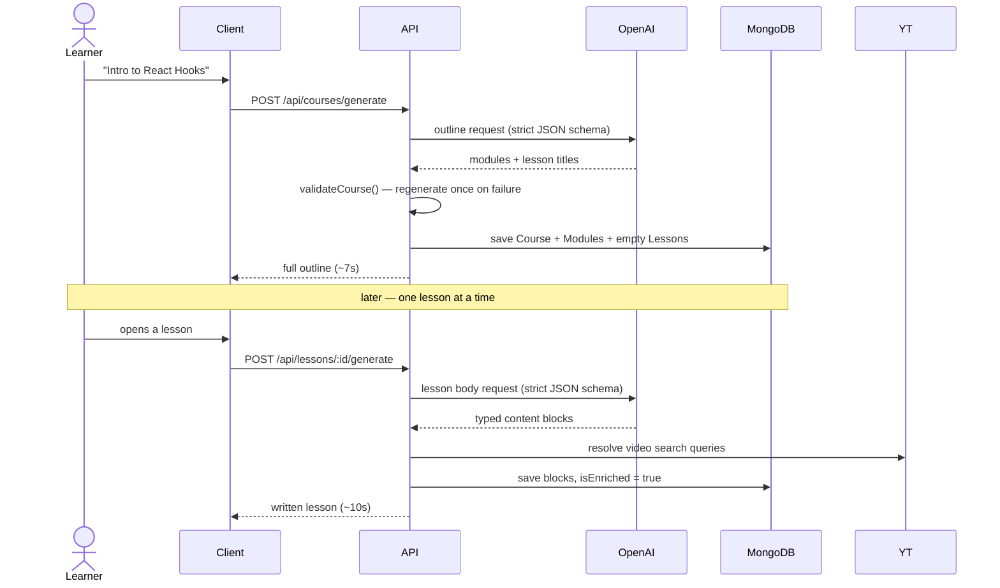
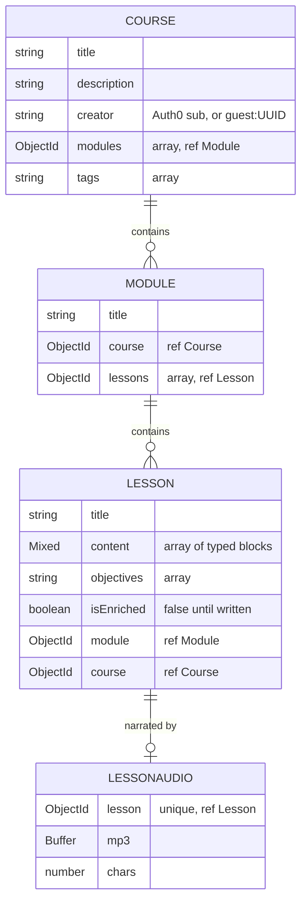

# LearnSmith

**Type a topic. Get a course.**

One line of text becomes a structured syllabus — ordered modules, written lessons, runnable code examples, real YouTube videos, and quizzes that explain their answers. Listen to any lesson narrated in Hinglish, or save it as a PDF.

| | |
|---|---|
| **Live app** | https://learn-smith.vercel.app/ |
| **API** | https://learnsmith-api.onrender.com |
| **Health** | https://learnsmith-api.onrender.com/api/health |

---

## Overview

Most AI learning tools hand you a wall of chat text. LearnSmith produces a **syllabus**: modules ordered by dependency, so no lesson relies on an idea you haven't met yet.

The core design decision is **two-phase generation**. Asking a model to write twenty full lessons up front means a four-minute wait for nineteen lessons you'll never open. Instead:

1. **The outline** is generated in one call (~7s) — modules and lesson titles only.
2. **A lesson body** is written the first time you actually open it (~10s), then saved forever.

Everything the model returns is checked against a hand-written contract before it's stored. If it fails, it's regenerated. You never see a broken course.

---

## Key Features

- **Dependency-ordered modules** — foundations first, applications last.
- **Lessons written on demand** — outline in seconds, bodies on first open, cached after.
- **Course-aware lessons** — each new lesson receives the course description, ordered outline, its position, and available objectives. Earlier topics describe planned coverage; they do not prove the learner has studied them.
- **Typed content blocks** — `heading`, `paragraph`, `code`, `video`, `mcq`. The renderer is one lookup table, not a switch.
- **Real videos, never hallucinated** — the model writes a *search query*; the server resolves it through the YouTube Data API. It can't invent a video id.
- **Quizzes that explain** — every question carries the reason the right answer is right.
- **A navigable lesson reader** — readable prose, learning goals, section links with an active-section outline, code copying, and keyboard-accessible self-checks that reveal feedback after submission. The outline adapts to the article's available width, including when the sidebar is resized.
- **Saved learning activity** — manual lesson completion, course completion counts, resume from the last opened lesson, and server-graded quiz history with retakes. Guests retain activity through their existing guest cookie; account activity follows the verified user identity.
- **Hinglish narration** — lesson prose is translated to Roman-script Hinglish, then spoken. Technical terms stay in English, because that's how they're said out loud.
- **PDF export** — the browser's own print pipeline against a print stylesheet. Real selectable text, not a screenshot.
- **Try without an account** — generation is open to guests; only your saved library needs a login.
- **Google sign-in through Auth0** — explicit Google buttons alongside Universal Login, with safe post-login navigation and understandable login errors. Configure the tenant's Google connection before using this in a deployment.

---

## System Architecture


**API keys never reach the browser.** The client talks to our server; our server talks to OpenAI and YouTube. That indirection is the only thing keeping the keys private — which is why `OPENAI_API_KEY` and `YOUTUBE_API_KEY` must never be given a `VITE_` prefix.

### How generation actually works



Two layers guard the output: OpenAI **structured outputs** (`response_format: json_schema`) force our field names and drop markdown fences, then `validateCourse` / `validateLesson` check what schemas can't — module counts, empty titles, duplicate sections, answer indices that point at nothing. A failure appends the model's own bad attempt to the conversation and retries once (`MAX_ATTEMPTS = 2`).

Lesson context comes from owner-checked stored course data, never a client-supplied outline. `lessonCourseContext.js` follows the course's module array and each module's lesson array, selects metadata only, and excludes cross-course or mismatched module references. It includes the course description (the existing course goal), current lesson position/objectives, and an ordered outline labeled earlier/current/later. Most unwritten lessons have titles only; objectives are included only when stored. No prerequisite bodies are generated or read, and no learner completion or mastery is inferred.

The serialized context is capped at 12,000 characters and 40 outline lessons, with bounded text fields. If needed, the builder keeps the current lesson separately, favors nearby earlier topics, then includes later topics, and reports omitted lessons. This bounds added prompt size, not exact token cost, and aims to improve continuity without guaranteeing teaching quality. Existing cached lessons are returned unchanged. A missing current lesson in the stored outline fails before allowance or AI work; cache hits and active competing claims skip context loading.

---

## Data Models



`creator` is **never read from the request body** — it comes from the verified JWT, or an individual guest identity in a signed HttpOnly cookie. Ownership is enforced by putting `creator` in the query itself, so another user's course returns `404`. `POST /api/session` establishes the guest cookie before other API calls. Guest cookies can be deleted, so guest allowances are a soft limit rather than proof of a unique person.

## Generation limits and accounting

Daily UTC allowances are defined in `server/config/usageLimits.js`: guests receive 1 course outline, 5 lesson bodies, and 2 narrations; signed-in free users receive 3 outlines, 20 lesson bodies, and 10 narrations. These initial limits are provisional. Cached lessons/audio and blocked duplicate claims consume no allowance. Admitted attempts consume allowance even if generation later fails.

Burst limits in `server/config/burstLimits.js` allow 20 generation POSTs per identity per 60-second window, shared across course, lesson, and audio routes. Session setup allows 60 requests per observed IP per window. These counters include cached and rejected requests; blocked requests receive `429` and `Retry-After` before reaching generation or quota consumption. GET routes remain available. Counters live in one process and reset on restart; multiple backend processes would need a shared store such as Redis. Verify the observed client IP through the deployed Vercel-to-Render proxy path before relying on the session IP limit.

Lesson claims use atomic database updates, expiring leases, and attempt IDs. Only the current, unexpired attempt can publish content. Quota checks run after ownership/cache/claim checks and before provider calls; quota rejection releases the lesson claim.

Lesson timing is defined in `server/config/lessonGenerationLimits.js`: a 30-second lease renews every 10 seconds while its owner is working. A stopped process therefore becomes recoverable about 30 seconds after its last successful renewal, without imposing a 30-second limit on a healthy generation. Stage checks run before AI retries, video lookup, and publication. A separate two-minute overall deadline bounds live but stuck requests. Ownership loss or renewal failure stops new stages; attempt IDs still fence publication/cleanup. This cannot cancel or undo a provider call already in flight. Audio has its own longer lease policy.

The lesson read response includes generation state computed with the server clock. A leftover `generating` flag becomes `retryable` when its lease expires. While a claim is active, the client checks the owner-scoped `GET /api/lessons/:id/generation` endpoint every three seconds and opens saved content when ready. It also checks after conflicts or an uncertain POST response. These reads never claim work, consume allowance, or call AI. Checks stop on navigation, an error, or a bounded waiting period; a new paid attempt always needs an explicit click. Expired or missing-lease claims can be reclaimed safely without manually clearing a live lock.

Audio uses its own claim in `LessonAudio`, with a unique lesson index, expiring lease, and attempt ID. The lease is renewed before translation and each speech chunk; an expired owner cannot renew, publish, or clear a replacement claim. Only an explicit **Generate audio** click starts narration. Source/translated text, chunk count, and stored bytes are bounded by `server/config/audioLimits.js`. Partial failures are not automatically retried or refunded. A manual retry starts the narration again, including any earlier successful chunks. Leases protect storage ownership; they cannot undo provider work already started before a crash or expiry.

Each course/lesson provider call has a `GenerationCall` record, including retries and responses rejected by validation. The initial record is saved before calling AI; failure to establish accounting stops new paid work. Usage is saved before truncation or content checks. Unknown outcomes or usage remain unknown rather than zero. A post-response accounting write failure preserves the paid result and emits metadata instead of triggering a duplicate provider call.

`GET /api/usage` returns the current owner's UTC-day allowances, course/lesson text totals under `generation`, and translation/speech totals under `audio`. Every translation and speech chunk has its own provider record. Translation tokens use the same versioned text rates in `server/config/modelPricing.js`. The binary MP3 response exposes no billed token usage, so speech records preserve input characters, output bytes, and the provider request ID while leaving token/cost fields unknown. A partial cost report includes `knownEstimatedCostUsd` but leaves `estimatedCostUsd` null. Unknown models or unsupported billing modes also remain unpriced. Estimates exclude hosting, taxes, and account-specific discounts.

Browser requests use same-origin `/api` forwarding through Vite locally and Vercel in production. A shared Promise coordinates guest setup within a page; Web Locks serialize setup across supported same-origin tabs. Browsers without Web Locks retain only page-local coordination. These browser mechanisms are not server-side abuse prevention.

The daily allowance panel appears beside the landing-page form and above app pages. It reads course, lesson, and narration counts from `/api/usage`, shows the reset in local time, and refreshes after successful or failed generation requests, window focus/tab visibility, manual refresh, and the server-provided daily reset. Account changes create a fresh display store so late responses cannot show the previous account's allowance. A failed refresh preserves labelled last-known counts; an initial failure shows unknown counts. The display never disables reading or cached playback: server-side checks remain authoritative.

On lesson pages the allowance panel collapses to a compact summary, keeping remaining counts visible. The reader provides learning goals, approximate prose reading time, an outline, optional narration controls, and PDF export. Outline anchors use block positions after removing an echoed title, so repeated headings remain distinct. Quiz submissions translate these positions back to the original content indices. Each lesson remounts its interactive reader to prevent sibling lessons from sharing quiz selections. The lesson route loads separately to keep its interactive code out of the initial landing-page bundle.

### Saved progress and quiz history

Written content and learner activity are separate. `LessonProgress` has a unique `(creator, lesson)` index and stores manual completion and the server-recorded last-opened time. Repeating a completion save preserves its original completion timestamp. Course and library counts are derived from existing written lessons and their progress records; retrying a save cannot increment a counter twice. Resume opens the most recently visited lesson, including an unwritten one; it does not restore a scroll position.

`QuizAttempt` stores an append-only answer snapshot. The server grades against the saved lesson, ignoring client scores or answer keys. A hash of the question, options, answer, and explanation identifies its version; stale questions are rejected, while earlier attempts keep their original text and result. A unique `(creator, submissionId)` index makes simultaneous or retried submissions return one stored attempt. Reusing an ID for different input returns a conflict. Retakes use new IDs, and history uses bounded cursor pages of 20 attempts.

All learning routes check course ownership using the verified user or existing signed guest cookie. Guest activity is not transferred into an account on sign-in, and deleting a guest cookie loses that browser's access to its guest records. These are self-study quizzes: lesson content still includes answers, so this is not a secure examination system. Saving progress or answers makes no AI calls and consumes no generation allowance. Learning writes have a separate identity burst bucket of 120 requests per minute on the current single-process server. Course deletion also removes its progress and quiz attempts.

| Method | Route | Purpose |
|---|---|---|
| GET | `/api/lessons/:id/learning` | Progress, current-question summaries, and quiz history; optional `before` cursor |
| POST | `/api/lessons/:id/visit` | Record a last-opened lesson |
| PUT | `/api/lessons/:id/progress` | Save `{ completed: boolean }` |
| POST | `/api/lessons/:id/quiz-attempts` | Save `{ submissionId, questionIndex, questionVersion, selectedOption }` |
| GET | `/api/courses/:id/progress` | Completion totals, lesson badges, and resume destination |

---

## Tech Stack

| Layer | Choice |
|---|---|
| Frontend | React 19, Vite 8, React Router 7 |
| Styling | Tailwind CSS v4 (design tokens in `client/src/index.css`) |
| Backend | Node 20+, Express 5 |
| Database | MongoDB Atlas, Mongoose 9 |
| AI | OpenAI SDK — chat completions (structured outputs) + text-to-speech |
| Video | YouTube Data API v3 |
| Auth | Auth0 (`@auth0/auth0-react`, `express-oauth2-jwt-bearer`) |
| Lint | oxlint |
| Hosting | Vercel (client) · Render (API) |

---

## API Reference

Base URL: `http://localhost:5000` in development.

### System

| Method | Endpoint | Auth | Description |
|---|---|---|---|
| `GET` | `/` | — | Service banner — tells "wrong URL" from "server down" |
| `GET` | `/api/health` | — | `ok`, `uptime`, `env`, `db`, and derived `features` flags |
| `POST` | `/api/session` | — | Establish or reuse a signed guest cookie |
| `GET` | `/api/usage` | Guest/account identity | Current UTC-day quotas and separate text/audio usage summaries |

### Courses

| Method | Endpoint | Auth | Description |
|---|---|---|---|
| `POST` | `/api/courses/generate` | Optional | Generate a course outline from a topic |
| `GET` | `/api/courses` | **Required** | List your saved courses |
| `GET` | `/api/courses/:id` | Optional | One course with its modules and lessons |
| `DELETE` | `/api/courses/:id` | Optional | Delete a course and everything under it |

### Lessons

| Method | Endpoint | Auth | Description |
|---|---|---|---|
| `GET` | `/api/lessons/:id` | Optional | One lesson, written or not |
| `GET` | `/api/lessons/:id/generation` | Optional | Read current generation state and saved content when ready; never generates |
| `POST` | `/api/lessons/:id/generate` | Optional | Write this lesson's body |
| `GET` | `/api/lessons/:id/audio` | Optional | Cached Hinglish mp3, or `404` |
| `POST` | `/api/lessons/:id/audio` | Optional | Translate + synthesize, then store |

**"Optional" means guest-accessible, not unscoped** — every route filters by `creator`, so guests see the guest library and signed-in users see their own. Only listing a library demands a real login.

`GET` reads, `POST` pays. The split matters for audio: a revalidation or a link preview must never trigger a billed synthesis.

---

## Getting Started

### Prerequisites

- Node.js 20 or newer
- A MongoDB Atlas cluster (or local `mongod`)
- An OpenAI API key
- *Optional:* YouTube Data API key (videos), Auth0 application (accounts)

### 1. Clone and install

```bash
git clone https://github.com/JaganPokala/LearnSmith.git
cd LearnSmith

cd server && npm install && cd ..
cd client && npm install && cd ..
```

### 2. Server environment

Create `.env` in the **project root** (see `.env.example` for the annotated version):

```bash
PORT=5000
NODE_ENV=development
CLIENT_ORIGIN=http://localhost:5173
GUEST_COOKIE_SECRET=<random 32-byte hex secret>

MONGO_URI=mongodb+srv://<user>:<pass>@<cluster>.mongodb.net/text-to-learn

OPENAI_API_KEY=sk-...
OPENAI_TEXT_MODEL=<a model your key can reach>
OPENAI_TTS_MODEL=<a speech model>      # optional — enables Hinglish audio

YOUTUBE_API_KEY=                        # optional — enables video blocks
AUTH0_ISSUER=                           # optional — enables accounts
AUTH0_AUDIENCE=
```

### 3. Client environment

Create `client/.env`:

```bash
VITE_AUTH0_DOMAIN=
VITE_AUTH0_CLIENT_ID=
VITE_AUTH0_AUDIENCE=
```

> Anything prefixed `VITE_` is **inlined into the browser bundle**. It is configuration, not a secret.

Generate the server cookie secret with `node -e "console.log(require('node:crypto').randomBytes(32).toString('hex'))"` and keep it stable across restarts and backend instances. API URLs are relative: the Vite proxy targets port 5000, and `client/vercel.json` forwards production API requests to Render. If the backend address or port changes, update the corresponding proxy configuration.

For database verification, set `TEST_MONGO_URI` locally. Scripts explicitly use the separate `learnsmith_generation_test` database and remove only their temporary records. From `server/`, run `npm run verify:generation`, `npm run verify:quota`, `npm run verify:controllers`, and `npm run verify:accounting`. Controller/accounting tests use fake provider calls, so they do not incur AI charges. Atlas access is still required.

Run `npm run verify:bursts` from `server/` to check burst limits using a temporary local HTTP server. This check needs neither MongoDB nor AI credentials.

Run `npm run verify:audio` from `server/` for audio concurrency, cache, ownership, quota, expiry, chunk limits, partial failures, and accounting checks. It uses the isolated Atlas test database, a temporary local HTTP server, and fake AI responses; there are no paid provider calls.

Run `npm run verify:usage` from `client/` for allowance-refresh signals, stale-response handling, account-store isolation, and refresh-error recovery. These checks mock fetch and require neither the backend nor MongoDB or AI credentials.

Run `npm run verify:reader` from `client/` to verify outline/anchor consistency, repeated and Unicode headings, echoed-title removal, malformed content, and the prose reading-time estimate. Browser checks use fake lessons to cover navigation, quiz submission and keyboard controls, per-lesson state reset, code copying, narrow-screen overflow, and the unwritten-to-written lesson flow.

Run `npm run verify:generation-watch` from `client/` for read-only generation polling, completion/expiry handling, cancellation, bounded waits, and status failures. It uses fake responses and incurs no provider cost. Server generation/controller checks also verify status ownership, no quota/AI work on status reads, and safe recovery of incomplete claims.

Run `npm run verify:lesson-lease` from `server/` for heartbeat timing, loss of ownership, renewal failures, the overall deadline, timer cleanup, and preventing a paid retry after losing ownership. It uses a fake clock and fake provider responses, with no real time sleeps, database access, or paid calls.

Run `npm run verify:course-context` from `server/` for ordered context, first/middle/last positions, missing objectives, foreign references, escaped/Unicode size bounds, and fake-provider retries. It needs no database or paid AI calls. `verify:controllers` additionally checks stored context through isolated database fixtures, unwritten earlier coverage, ignored client context, foreign references, and invalid-outline cleanup.

Run `npm run verify:learning` from `server/` for progress/quiz ownership, guest isolation, concurrent completion, server grading, idempotent submissions, retakes, version changes, cursor pages, library summaries, and deletion cleanup. It uses the isolated Atlas test database and no provider calls. Run the same command from `client/` for saved-state acknowledgement, stale responses, account/lesson isolation, history refresh failures, original question indexing, and ensuring learning writes do not emit generation events. The client checks need no backend or database.

### 4. Run

#### Google login setup

The existing Auth0 application and API stay in use. Enable the `google-oauth2`
social connection for the frontend application. The Google button passes that
connection to Auth0; the other button opens Universal Login for existing methods.

For your own Google credentials, create a Google Cloud OAuth client of type
**Web application**. Its JavaScript origin is `https://YOUR_AUTH0_DOMAIN` and its
redirect URI is `https://YOUR_AUTH0_DOMAIN/login/callback`. Enter its Client ID
and Client Secret in **Auth0 → Authentication → Social → google-oauth2**. Secrets
belong in Auth0, not a `VITE_*` variable. Auth0's shared developer keys are for
development; replace them with your own credentials before production. See the
[Auth0 Google setup guide](https://auth0.com/blog/adding-google-login-to-react-app-with-auth0/).

These Google-to-Auth0 callback settings are separate from Auth0's application
callback/logout/web-origin allowlists, which include the exact frontend origins
such as `http://localhost:5173` and the deployed Vercel origin. Configure the
Google consent screen/audience and add test users if applicable to the app's
Google publishing status. Only basic sign-in/profile permissions are needed.

After login, Auth0 issues the access token for this app's API audience. Existing
backend JWT verification and owner checks apply to all providers. Ownership uses
the verified subject claim; matching email addresses do not merge Google and
password identities. Guest courses also stay separate from the account library.

The app returns to `/courses` after sign-in, using React Router navigation to
remove callback parameters. Return targets are limited to local app routes.
Run `npm run verify:sign-in` from `client/` for connection selection, safe return
targets, and safe error messages. Fake-provider browser checks cover failed login,
callback routing, authenticated library reads, refresh, sign-out, existing sign-in
options, and narrow layout. A real Google round trip must also be checked after
the tenant connection is configured.

#### Start the app

```bash
cd server && npm run dev     # http://localhost:5000
cd client && npm run dev     # http://localhost:5173
```

Every optional key is genuinely optional. `/api/health` reports which features are live, and the UI hides what the server can't do rather than offering a button that fails:

```json
{ "database": true, "generation": true, "tts": true, "video": true, "auth": true }
```

### Scripts

| Directory | Command | Does |
|---|---|---|
| `server` | `npm run dev` | Start with `--watch` |
| `server` | `npm start` | Start for production |
| `client` | `npm run dev` | Vite dev server |
| `client` | `npm run build` | Production build to `dist/` |
| `client` | `npm run lint` | oxlint |

---

## Deployment

**API → Render.** Root directory `server`, build `npm install`, start `npm start`. Set every server variable above, plus `CLIENT_ORIGIN` pointing at your Vercel URL (CORS is an allowlist, never `*`). `SIGTERM` is handled, so redeploys drain in-flight requests instead of 502-ing a generation mid-flight.

**Client → Vercel.** Root directory `client`. `client/vercel.json` forwards `/api` requests to Render before rewriting other paths to `index.html` for client-side routing. `VITE_*` values are baked in **at build time**, so changing one requires a rebuild, not a restart.

Audio remains synchronous. The browser allows up to seven minutes for bounded multi-chunk generation, but the deployed proxy may impose a shorter deadline. Verify long narration through Vercel; a client timeout does not cancel server work. Moving narration to background jobs with status polling remains a future deployment improvement.

The current Speech API integration also needs a planned migration: OpenAI lists the legacy TTS models for shutdown on January 6, 2027. The replacement requires a different API workflow, not just a model-name change. See the [official text-to-speech guide](https://developers.openai.com/api/docs/guides/text-to-speech).

---

## Engineering Notes

- **Feature flags are derived, never hand-maintained.** `features` is computed from which config is actually present, so `/api/health` cannot drift into lying about what works.
- **Every request is traced** with an id, so a CORS refusal or a slow model call is attributable instead of anonymous.
- **Timeouts are chosen against measurements**, not vibes — and the client's deadline deliberately exceeds the server's, so it never cancels work that was about to succeed.
- **Colour lives in tokens.** The entire dark-to-light PDF conversion is one `@media print` block that redefines CSS variables; no component knows it's being printed.

---

## License

MIT
