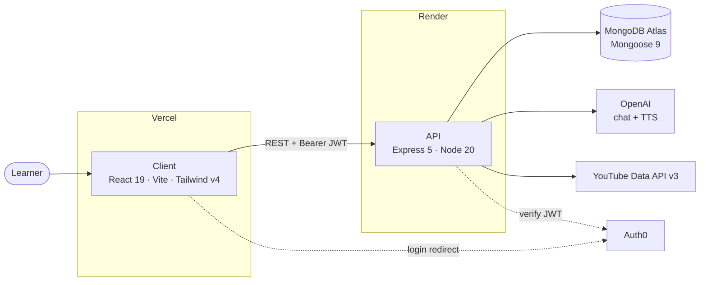
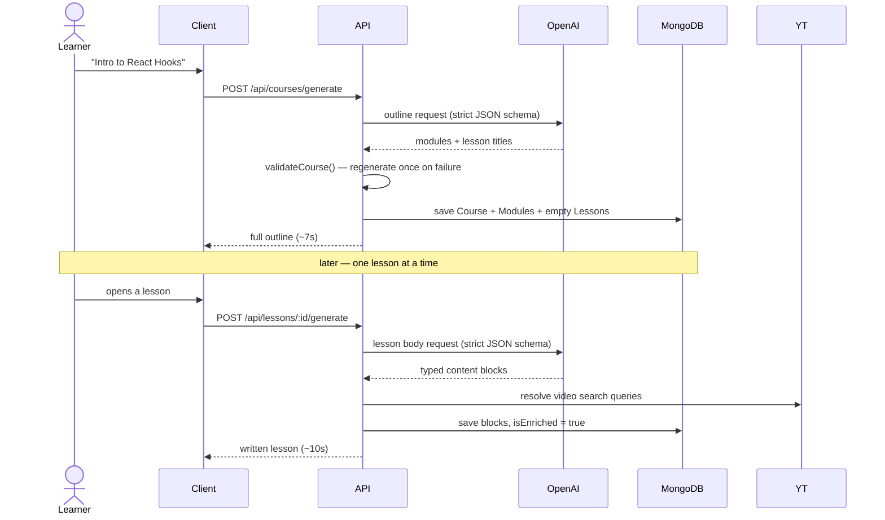
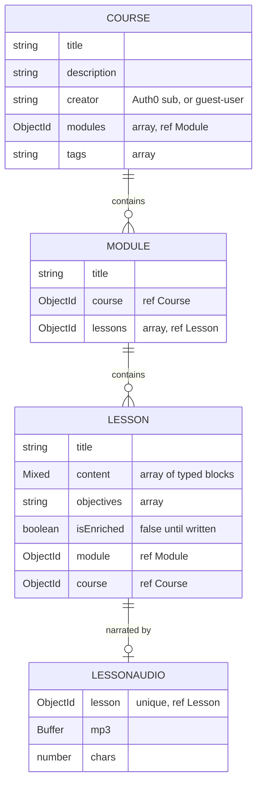

# LearnSmith

**Type a topic. Get a course.**

One line of text becomes a structured syllabus — ordered modules, written lessons, runnable code examples, real YouTube videos, and quizzes that explain their answers. Listen to any lesson narrated in Hinglish, or save it as a PDF.

| | |
|---|---|
| **Live app** | _add your Vercel URL_ |
| **API** | https://learnsmith-api.onrender.com |
| **Health** | https://learnsmith-api.onrender.com/api/health |

---

## Overview

Most AI learning tools hand you a wall of chat text. LearnSmith produces a **syllabus**: modules ordered by dependency, so no lesson relies on an idea you haven't met yet.

The core design decision is **two-phase generation**. Asking a model to write twenty full lessons up front means a four-minute wait for nineteen lessons you'll never open. Instead:

1. **The outline** is generated in one call (~7s) — modules and lesson titles only.
2. **A lesson body** is written the first time you actually open it (~10s), then saved forever.

Everything the model returns is checked against a hand-written contract before it's stored. If it fails, it's regenerated. You never see a broken course.

---

## Key Features

- **Dependency-ordered modules** — foundations first, applications last.
- **Lessons written on demand** — outline in seconds, bodies on first open, cached after.
- **Typed content blocks** — `heading`, `paragraph`, `code`, `video`, `mcq`. The renderer is one lookup table, not a switch.
- **Real videos, never hallucinated** — the model writes a *search query*; the server resolves it through the YouTube Data API. It can't invent a video id.
- **Quizzes that explain** — every question carries the reason the right answer is right.
- **Hinglish narration** — lesson prose is translated to Roman-script Hinglish, then spoken. Technical terms stay in English, because that's how they're said out loud.
- **PDF export** — the browser's own print pipeline against a print stylesheet. Real selectable text, not a screenshot.
- **Try without an account** — generation is open to guests; only your saved library needs a login.

---

## System Architecture



**API keys never reach the browser.** The client talks to our server; our server talks to OpenAI and YouTube. That indirection is the only thing keeping the keys private — which is why `OPENAI_API_KEY` and `YOUTUBE_API_KEY` must never be given a `VITE_` prefix.

### How generation actually works



Two layers guard the output: OpenAI **structured outputs** (`response_format: json_schema`) force our field names and drop markdown fences, then `validateCourse` / `validateLesson` check what schemas can't — module counts, empty titles, duplicate sections, answer indices that point at nothing. A failure appends the model's own bad attempt to the conversation and retries once (`MAX_ATTEMPTS = 2`).

---

## Data Models



`creator` is **never read from the request body** — it comes from the verified JWT, or the shared `guest-user` identity. Ownership is enforced by putting `creator` in the query itself, so another user's course returns `404`, not `403`: "that isn't yours" and "that doesn't exist" should look identical from outside.

---

## Tech Stack

| Layer | Choice |
|---|---|
| Frontend | React 19, Vite 8, React Router 7 |
| Styling | Tailwind CSS v4 (design tokens in `client/src/index.css`) |
| Backend | Node 20+, Express 5 |
| Database | MongoDB Atlas, Mongoose 9 |
| AI | OpenAI SDK — chat completions (structured outputs) + text-to-speech |
| Video | YouTube Data API v3 |
| Auth | Auth0 (`@auth0/auth0-react`, `express-oauth2-jwt-bearer`) |
| Lint | oxlint |
| Hosting | Vercel (client) · Render (API) |

---

## API Reference

Base URL: `http://localhost:5000` in development.

### System

| Method | Endpoint | Auth | Description |
|---|---|---|---|
| `GET` | `/` | — | Service banner — tells "wrong URL" from "server down" |
| `GET` | `/api/health` | — | `ok`, `uptime`, `env`, `db`, and derived `features` flags |

### Courses

| Method | Endpoint | Auth | Description |
|---|---|---|---|
| `POST` | `/api/courses/generate` | Optional | Generate a course outline from a topic |
| `GET` | `/api/courses` | **Required** | List your saved courses |
| `GET` | `/api/courses/:id` | Optional | One course with its modules and lessons |
| `DELETE` | `/api/courses/:id` | Optional | Delete a course and everything under it |

### Lessons

| Method | Endpoint | Auth | Description |
|---|---|---|---|
| `GET` | `/api/lessons/:id` | Optional | One lesson, written or not |
| `POST` | `/api/lessons/:id/generate` | Optional | Write this lesson's body |
| `GET` | `/api/lessons/:id/audio` | Optional | Cached Hinglish mp3, or `404` |
| `POST` | `/api/lessons/:id/audio` | Optional | Translate + synthesize, then store |

**"Optional" means guest-accessible, not unscoped** — every route filters by `creator`, so guests see the guest library and signed-in users see their own. Only listing a library demands a real login.

`GET` reads, `POST` pays. The split matters for audio: a revalidation or a link preview must never trigger a billed synthesis.

---

## Getting Started

### Prerequisites

- Node.js 20 or newer
- A MongoDB Atlas cluster (or local `mongod`)
- An OpenAI API key
- *Optional:* YouTube Data API key (videos), Auth0 application (accounts)

### 1. Clone and install

```bash
git clone https://github.com/JaganPokala/LearnSmith.git
cd LearnSmith

cd server && npm install && cd ..
cd client && npm install && cd ..
```

### 2. Server environment

Create `.env` in the **project root** (see `.env.example` for the annotated version):

```bash
PORT=5000
NODE_ENV=development
CLIENT_ORIGIN=http://localhost:5173

MONGO_URI=mongodb+srv://<user>:<pass>@<cluster>.mongodb.net/text-to-learn

OPENAI_API_KEY=sk-...
OPENAI_TEXT_MODEL=<a model your key can reach>
OPENAI_TTS_MODEL=<a speech model>      # optional — enables Hinglish audio

YOUTUBE_API_KEY=                        # optional — enables video blocks
AUTH0_ISSUER=                           # optional — enables accounts
AUTH0_AUDIENCE=
```

### 3. Client environment

Create `client/.env`:

```bash
VITE_API_URL=http://localhost:5000

VITE_AUTH0_DOMAIN=
VITE_AUTH0_CLIENT_ID=
VITE_AUTH0_AUDIENCE=
```

> Anything prefixed `VITE_` is **inlined into the browser bundle**. It is configuration, not a secret.

### 4. Run

```bash
cd server && npm run dev     # http://localhost:5000
cd client && npm run dev     # http://localhost:5173
```

Every optional key is genuinely optional. `/api/health` reports which features are live, and the UI hides what the server can't do rather than offering a button that fails:

```json
{ "database": true, "generation": true, "tts": true, "video": true, "auth": true }
```

### Scripts

| Directory | Command | Does |
|---|---|---|
| `server` | `npm run dev` | Start with `--watch` |
| `server` | `npm start` | Start for production |
| `client` | `npm run dev` | Vite dev server |
| `client` | `npm run build` | Production build to `dist/` |
| `client` | `npm run lint` | oxlint |

---

## Deployment

**API → Render.** Root directory `server`, build `npm install`, start `npm start`. Set every server variable above, plus `CLIENT_ORIGIN` pointing at your Vercel URL (CORS is an allowlist, never `*`). `SIGTERM` is handled, so redeploys drain in-flight requests instead of 502-ing a generation mid-flight.

**Client → Vercel.** Root directory `client`. `client/vercel.json` rewrites all paths to `index.html` for client-side routing. `VITE_*` values are baked in **at build time**, so changing one requires a rebuild, not a restart.

---

## Engineering Notes

- **Feature flags are derived, never hand-maintained.** `features` is computed from which config is actually present, so `/api/health` cannot drift into lying about what works.
- **Every request is traced** with an id, so a CORS refusal or a slow model call is attributable instead of anonymous.
- **Timeouts are chosen against measurements**, not vibes — and the client's deadline deliberately exceeds the server's, so it never cancels work that was about to succeed.
- **Colour lives in tokens.** The entire dark-to-light PDF conversion is one `@media print` block that redefines CSS variables; no component knows it's being printed.

---

## License

MIT
